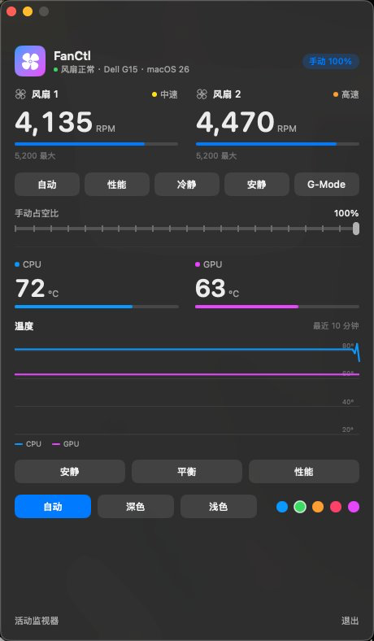

# G15 FanCtl — Dell G15 fan control for macOS

**中文说明：[README.zh-CN.md](README.zh-CN.md)**

Fan control for **Dell G15 (5511 / Comet Lake-H + RTX 3060 Laptop)** running macOS 26 (Tahoe),
via the AWCC ACPI WMI interface exposed by the BIOS.



> ⚠️ **Tested only on a Dell G15 5511.** Other models may differ. Writing EC registers is
> potentially risky — use at your own risk. Not affiliated with Dell or Apple.

## Features

- Thermal modes: Balanced / Performance / Cool / Quiet / G-Mode
- Per-fan duty cycle (0–100 %)
- Fan RPM readout (EC `0x57` / `0x59`)
- GPU temperature (`IOAccelerator` → `PerformanceStatistics`)
- Fan curve presets (silent / balanced / performance)
- `fanctl diag` diagnostics
- Restores the last mode/duty at boot
- Menu bar option to show fan RPM
- App icon
- SwiftUI control panel + menu bar app, login item
- Dual fan RPM gauges, live CPU/GPU temperature chart, manual duty slider
- Appearance themes: follow system / dark / light + accent colors
- CLI: `fanctl mode|duty|rpm|status`

## How it works

The BIOS exposes an ACPI device `AMWW` (`_UID = "AWCC"`) with a WMI dispatcher `WMAX`:

```
WMAX(0, 0x15, {1, mode, 0})        → AX23 → AX26 → EC 0x22 + fan duty on EC 0x21/0x23
WMAX(0, 0x15, {2, fanId, duty})    → AX24 → EC 0x21 (fan 0x32) / 0x23 (fan 0x33)
WMAX(0, 0x25, {2, 0, 0})           → AX28 → read EC 0x50
```

Thermal mode values: `0xA0` balanced, `0xA1` performance, `0xA2` cool, `0xA3` quiet,
`0xAB` G-Mode (all fans 100 %), `0` custom.

Fan tachometers: EC `0x57` (fan 1) and `0x59` (fan 2).

The kext (`FanProbe`) calls `\_SB.AMWW.WMAX` through `IOACPIPlatformDevice::evaluateObject`
and exposes `kern.fanprobe.*` sysctls. An additional SSDT (`SSDT-FANEC`) adds a small
`DSHF.RDEC` method so the kext can read arbitrary EC registers.

## Install

1. Put `FanProbe.kext` into `EFI/OC/Kexts/` and add a `Kernel → Add` entry
   (`BundlePath FanProbe.kext`, `ExecutablePath Contents/MacOS/FanProbe`,
   `PlistPath Contents/Info.plist`).
2. Put `SSDT-FANEC.aml` into `EFI/OC/ACPI/` and add an `ACPI → Add` entry.
3. Reboot.
4. Install the CLI: `sudo cp cli/fanctl /usr/local/bin/fanctl && sudo chmod 755 /usr/local/bin/fanctl`
5. Optional: build the app and copy `FanCtl.app` to `/Applications`.

## Build

Requirements: Xcode Command Line Tools (`clang`, `swiftc`), and ACPICA `iasl` for the SSDT.

If `iasl` is not installed, build ACPICA from source or `brew install acpica`, then run
`IASL=/path/to/iasl ./ssdt/build.sh`.

```bash
./kext/build.sh     # builds kext/FanProbe.kext
./ssdt/build.sh     # builds ssdt/SSDT-FANEC.aml
./app/build.sh      # builds app/FanCtl.app
```

The kext must define `_kmod_info` (see `KMOD_EXPLICIT_DECL` in `FanProbe.cpp`) and declare a
dependency on `com.apple.iokit.IOACPIFamily`.

## Usage

```bash
fanctl mode balanced|perf|cool|quiet|g|auto
fanctl duty 1 50          # fan 1 at 50 %
fanctl duty 2 100         # fan 2 at 100 %
fanctl rpm                # read fan speeds
fanctl status             # last call result
```

`kern.fanprobe.lastret` is `0` on success.

## Limitations

- Settings apply immediately and are lost on reboot/power loss (the EC resets to auto).
- The macOS system disk is on USB in the tested setup, so its SSD temperature is not
  readable (SMART unsupported over USB). Internal NVMe SMART temperature would need
  additional CFPlugIn work — not included.
- The ACPI/EC interface is model-specific and undocumented; this is a reverse-engineered
  implementation, not a Dell-supported API.

## Credits

- `app/smcread.c` — independent implementation of the AppleSMC key read protocol.
- SSDT is compiled with Intel ACPICA `iasl` (build-time only).
