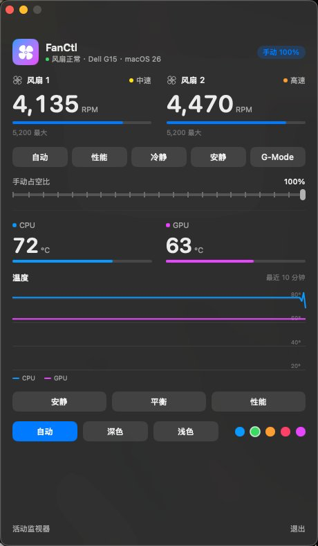

# G15 FanCtl — 戴尔 G15 macOS 风扇控制

在 **Dell G15（5511 / i7-11800H + RTX 3060 Laptop）** 上运行 macOS 26（Tahoe），
通过 BIOS 暴露的 AWCC ACPI WMI 接口控制风扇。



> ⚠️ **仅在 Dell G15 5511 上实测。** 其他机型可能不同。写 EC 寄存器有风险，使用后果自负。
> 与 Dell、Apple 无关。

## 功能

- 热模式：平衡 / 性能 / 冷静 / 安静 / G-Mode
- 单风扇占空比（0–100%）
- 风扇转速读取（EC `0x57` / `0x59`）
- GPU 温度（`IOAccelerator` → `PerformanceStatistics`）
- 风扇曲线预设（安静 / 平衡 / 性能）
- `fanctl diag` 一键自检
- 开机恢复上次模式/占空比
- 菜单栏可选显示转速
- App 图标
- SwiftUI 控制面板 + 菜单栏 App，登录自启
- 双风扇大数字 RPM、CPU/GPU 实时温度曲线、手动占空比滑块
- 外观主题：跟随系统 / 深色 / 浅色 + 强调色
- 命令行：`fanctl mode|duty|rpm|status`

## 原理

BIOS 在 ACPI 里暴露了一个 `AMWW` 设备（`_UID = "AWCC"`），带有 WMI 调度方法 `WMAX`：

```
WMAX(0, 0x15, {1, mode, 0})        → AX23 → AX26 → 写 EC 0x22 + 风扇占空比到 EC 0x21/0x23
WMAX(0, 0x15, {2, fanId, duty})    → AX24 → EC 0x21（风扇 0x32）/ 0x23（风扇 0x33）
WMAX(0, 0x25, {2, 0, 0})           → AX28 → 读 EC 0x50
```

热模式值：`0xA0` 平衡、`0xA1` 性能、`0xA2` 冷静、`0xA3` 安静、
`0xAB` G-Mode（双风扇 100%）、`0` 自定义。

风扇转速：EC `0x57`（风扇 1）、`0x59`（风扇 2）。

kext（`FanProbe`）通过 `IOACPIPlatformDevice::evaluateObject` 调用 `\_SB.AMWW.WMAX`，
并暴露 `kern.fanprobe.*` 系列 sysctl。另外用 `SSDT-FANEC` 增加了一个 `DSHF.RDEC` 方法，
让 kext 能读取任意 EC 寄存器。

## 安装

1. 把 `FanProbe.kext` 放进 `EFI/OC/Kexts/`，并在 `Kernel → Add` 里加一项
   （`BundlePath FanProbe.kext`、`ExecutablePath Contents/MacOS/FanProbe`、
   `PlistPath Contents/Info.plist`）。
2. 把 `SSDT-FANEC.aml` 放进 `EFI/OC/ACPI/`，并在 `ACPI → Add` 里加一项。
3. 重启。
4. 安装命令行：`sudo cp cli/fanctl /usr/local/bin/fanctl && sudo chmod 755 /usr/local/bin/fanctl`
5. 可选：构建 App 并把 `FanCtl.app` 复制到 `/Applications`。

## 构建

需要 Xcode Command Line Tools（`clang`、`swiftc`），SSDT 需要 ACPICA 的 `iasl`。

```bash
./kext/build.sh     # 生成 kext/FanProbe.kext
./ssdt/build.sh     # 生成 ssdt/SSDT-FANEC.aml
./app/build.sh      # 生成 app/FanCtl.app
```

如果没装 `iasl`，可以从 ACPICA 源码编译或 `brew install acpica`，然后
`IASL=/path/to/iasl ./ssdt/build.sh`。

## 用法

```bash
fanctl mode balanced|perf|cool|quiet|g|auto
fanctl duty 1 50          # 风扇 1 设为 50%
fanctl duty 2 100         # 风扇 2 设为 100%
fanctl rpm                # 读取转速
fanctl status             # 查看最近一次调用结果
```

`kern.fanprobe.lastret` 为 `0` 表示调用成功。

## 限制

- 设置立即生效，重启/断电后丢失（EC 恢复自动）。
- 测试环境下 macOS 系统盘是 USB 的，SSD 温度读不到（USB 不支持 SMART）。
  内置 NVMe 的 SMART 温度需要额外的 CFPlugIn 实现，暂未包含。
- ACPI/EC 接口是机型私有、未公开的，这是逆向实现，不是 Dell 官方 API。

## 致谢

- `app/smcread.c` —— 独立实现的 AppleSMC 读取协议。
- SSDT 使用 Intel ACPICA 的 `iasl` 编译（仅构建时依赖）。
