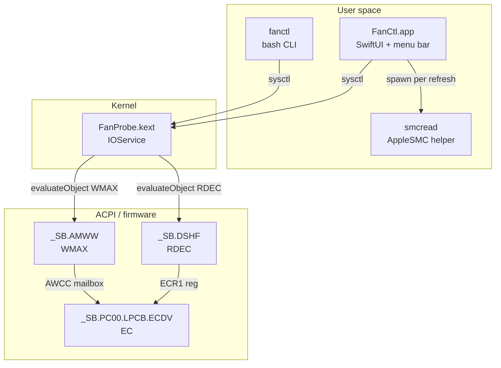
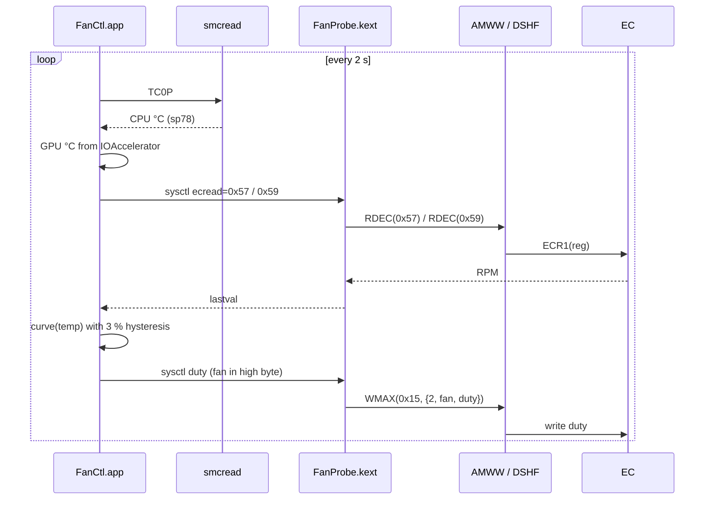

# Architecture

This document explains how FanCtl is put together, from the ACPI firmware interface up to
the SwiftUI app. It is the companion to [EC-REGISTERS.md](EC-REGISTERS.md), which documents
the individual EC addresses and the experiments used to identify them.

The implementation targets **Dell G15 5511** (Comet Lake-H, RTX 3060 Laptop) running macOS 26
on OpenCore. The ACPI/EC interface is model-specific and reverse-engineered; none of it is a
Dell- or Apple-supported API.

## 1. Design goals

- Keep the kernel component small and auditable: it only forwards ACPI calls and exposes
  sysctls. Policy (curves, presets, UI) lives in user space.
- Avoid private Apple frameworks. CPU temperature is read with an independent AppleSMC key
  reader; GPU temperature comes from the public `IOAccelerator` registry property.
- Fail safe: every ACPI call result is exposed through `kern.fanprobe.lastret`. The CLI checks
  it and falls back to the firmware's automatic/balanced mode (`0xA0`); the app records the
  return code in `lastMsg` for mode changes but does not auto-recover, and its duty path does
  not check `lastret`.
- One control plane for the app and the CLI: both write the same `kern.fanprobe.*` sysctls,
  so they can be used interchangeably.

## 2. Layer map

| Layer | Artifact | Runs as | Responsibility |
| --- | --- | --- | --- |
| UI | `app/FanCtl.app` (`app/main.swift`) | user | Menu bar item, SwiftUI panel, fan curves, sensors, notifications |
| CLI | `cli/fanctl` | user (or root) | Scriptable mode/duty/RPM/diagnostics/restore |
| Sensor helper | `app/smcread.c` | user | Read one AppleSMC key (`TC0P`) |
| Kernel | `kext/FanProbe.kext` (`kext/FanProbe.cpp`) | kernel | Resolve ACPI devices, call `WMAX`/`RDEC`, expose sysctls |
| ACPI | `ssdt/SSDT-FANEC.aml` (`ssdt/SSDT-FANEC.dsl`) | firmware | Add `\_SB.DSHF.RDEC`, a callable wrapper around the EC read method |
| Firmware | `\_SB.AMWW`, `\_SB.PC00.LPCB.ECDV` | firmware | AWCC WMI dispatcher and the embedded controller |



## 3. Boot-time topology

OpenCore injects two artifacts before macOS starts:

1. `SSDT-FANEC.aml` in `EFI/OC/ACPI/`, added to `ACPI → Add`.
2. `FanProbe.kext` in `EFI/OC/Kexts/`, added to `Kernel → Add` with
   `BundlePath FanProbe.kext`, `ExecutablePath Contents/MacOS/FanProbe`,
   `PlistPath Contents/Info.plist`, and `MinKernel`/`MaxKernel` as needed.

The SSDT creates a new ACPI device so that the kext has a stable, callable object:

```asl
Device (DSHF)
{
    Name (_HID, "DSHF0001")
    Name (_UID, Zero)
    Method (RDEC, 1, Serialized) { Return (\_SB.PC00.LPCB.ECDV.ECR1 (Arg0)) }
}
```

`ECR1` is defined in the Dell DSDT, but the project wraps it in a dedicated SSDT device
(`DSHF`, `_HID = "DSHF0001"`) rather than reaching into the DSDT's EC device. The kext then
resolves one stable device path for EC reads. `RDEC` is a one-argument pass-through;
`Serialized` prevents overlapping EC transactions from this method.

The kext matches `AppleACPIPlatformExpert` with `IOProbeScore = 1000`, then resolves:

- `IOACPIPlane:/_SB/AMWW` → the AWCC WMI device (`_UID = "AWCC"`, `PNP0C14`).
- `IOACPIPlane:/_SB/DSHF` → the SSDT helper device.

`AMWW` is required: if it is missing, `start()` returns `false`, the kext does not register its
sysctls, and `DevicePath` records `not-found`. `DSHF` is optional at load time: the kext still
registers, but EC reads set `lastret = -4` and return `EIO`. The `DevicePath`/`EcDevice`
registry properties record what was found. A sanity call with command `0x21`
(`wmax(0x21, 0, 0, 0)` in the kext) runs at start and its result is stored in
`Sanity21`/`SanityRet` for diagnostics.

## 4. ACPI contract

### 4.1 `AMWW.WMAX`

The kext marshals a call as:

```text
WMAX(0, command, { arg0, arg1, arg2, 0 }) -> OSNumber
```

The first parameter is always `0`; the second is the AWCC command; the third is a four-byte
`OSData` payload. The return value is an `OSNumber` whose low 32 bits are exposed as
`lastval`.

| Command | Payload | Effect |
| --- | --- | --- |
| `0x15` | `{1, mode, 0}` | Set thermal mode (see below) |
| `0x15` | `{2, fanId, duty}` | Set fan duty: `fanId` `0x32` = fan 1, `0x33` = fan 2; `duty` 0–100 |
| `0x25` | `{2, 0, 0}` | Read EC `0x50` (telemetry; value observed as `0`) |
| `0x21` | `{0, 0, 0}` | Startup sanity call (observed return value `2`) |

Thermal mode values:

| Mode | Value |
| --- | --- |
| Balanced | `0xA0` (160) |
| Performance | `0xA1` (161) |
| Cool | `0xA2` (162) |
| Quiet | `0xA3` (163) |
| G-Mode | `0xAB` (171) |
| Custom / automatic | `0` (0) |

The CLI's `auto`/`custom` aliases write `0`; the app's "Auto" button writes `0xA0`
(balanced), which is also the firmware default used by the curve engine.

The BIOS maps these commands onto EC registers. The register-level details, including which
values are readable back through `RDEC`, are in [EC-REGISTERS.md](EC-REGISTERS.md).

### 4.2 `DSHF.RDEC`

`RDEC(reg)` returns the EC value read through `ECR1(reg)`. On the tested firmware `ECR1`
returns a 16-bit value for the tachometer addresses `0x57` and `0x59`; the adjacent
addresses `0x58`/`0x5A` read `0`. Do not assume a byte-pair layout — see the register
document for the measured behaviour.

## 5. Kernel extension

`FanProbe` is a minimal `IOService`:

- `start()` resolves the ACPI objects, performs the sanity call, registers sysctls, and calls
  `registerService()`.
- `stop()` unregisters the sysctls and drops the device pointers.
- `wmax()` allocates the `OSData`/`OSNumber` arguments, calls
  `IOACPIPlatformDevice::evaluateObject("WMAX", ...)`, and releases everything.
- `RDEC` is called the same way with one `OSNumber` argument.

### 5.1 Sysctl ABI

Namespace: `kern.fanprobe`.

| Name | Type | Direction | Encoding / meaning |
| --- | --- | --- | --- |
| `mode` | int | write | Thermal mode value (`0xA0`–`0xAB`, `0`). Reading returns 0; use `lastmode`. |
| `duty` | int | write | `fanId` in the high byte, duty in the low byte (`0x32xx` fan 1, `0x33xx` fan 2); duty 0–100 |
| `ecread` | int | write | EC address to read; result appears in `lastval` |
| `ec50` | int | write | Triggers `WMAX(0x25, {2,0,0})`; result appears in `lastval` |
| `lastret` | int | read | Last `IOReturn`/internal error code (`0` = success) |
| `lastval` | int | read | Last returned value (WMAX value or EC byte/word) |
| `lastmode` | int | read | Last mode written to `mode`, or `-1` if none |

All four write-only entries use `sysctl_handle_int`; a write with `newptr != 0` performs the
operation. All entries are registered with `CTLFLAG_ANYBODY`, so any local user can call
them. The design assumes a single-user workstation; it is not a privilege boundary.

### 5.2 Return codes

`wmax()` returns:

| Code | Meaning |
| --- | --- |
| `0` | `evaluateObject` succeeded and returned an `OSNumber` |
| `-1` | `AMWW` device was not resolved |
| `-2` | Failed to allocate arguments |
| `-3` | ACPI call succeeded but the result was not an `OSNumber` |
| other | The raw `IOReturn` from `evaluateObject` |

`RDEC` additionally returns `-4` when `DSHF` is missing; the sysctl handler then returns
`EIO`.

### 5.3 Concurrency

`lastret`, `lastval`, and `lastmode` are global variables with no lock. They are a mailbox,
not a per-caller result. The app reads two tach registers every two seconds; a CLI command
that reads `lastval` at the same time can observe the app's value. For reliable register
dumps, quit the app first. This is a known limitation of the v1/v2 sysctl ABI; a future
revision could return the value directly from a read or use an ioctl.

## 6. User space

### 6.1 CLI (`cli/fanctl`)

| Command | Behaviour |
| --- | --- |
| `mode` (balanced, perf, cool, quiet, g, auto) | Writes `mode`, checks `lastret`, saves state |
| `duty <1 or 2> <0-100>` | Encodes `0x32`/`0x33` and duty, writes `duty`, saves state |
| `rpm` | Reads EC `0x57` and `0x59`, prints both |
| `status` | Prints `lastmode`, `lastret`, `lastval`, and the saved state |
| `diag` | Checks kext load, sysctl presence, tach reads, and state |
| `restore` | Re-applies the saved mode/duty (for a boot LaunchDaemon) |

On a non-zero `lastret`, `apply_mode` and `apply_duty` log the failure, write mode `0xA0`
(balanced/auto), and exit with status 2. State is written to `/Users/Shared/fanctl.state`;
the log is `/Users/Shared/fanctl.log`.

### 6.2 App (`app/main.swift`)

The app is an `LSUIElement` accessory application: it has a menu bar item and a SwiftUI
window, but no Dock icon.

- A 2-second timer drives `FanModel.refresh()`.
- CPU temperature: `smcread TC0P` (`sp78`), executed as a child process from
  `Contents/Resources/smcread`.
- GPU temperature: first `IOAccelerator` service with a `PerformanceStatistics` dictionary,
  key `Temperature(C)`.
- Fan RPM: EC `0x57`/`0x59` through `kern.fanprobe.ecread` + `lastval`.
- Curve engine: piecewise-linear interpolation over a temperature→duty table, per fan.
  Presets are `silent`, `balanced`, `performance`, plus a user-editable `custom` curve stored
  in `UserDefaults` (`fanctl.customCurve`).
- Hysteresis: a new duty is written only when it differs from the last applied duty by at
  least 3 percentage points, avoiding sysctl/EC churn.
- Manual mode: per-fan sliders write a fixed duty and disable the curve.
- Thermal mode buttons: Balanced/Performance/Cool/Quiet/G-Mode write the corresponding mode
  value and disable the curve.
- High-temperature notification: at ≥ 92 °C, at most once every 300 seconds, through
  `UNUserNotificationCenter`.
- Appearance and language: `UserDefaults` keys `fanctl.appearance`, `fanctl.accent`,
  `fanctl.lang`; the UI is bilingual (Chinese/English).
- Menu bar: optional stacked RPM display (`fanctl.menuRPM`); the temperature text turns red
  at ≥ 90 °C.

The app writes the same state file as the CLI:

- `mode=<value>` after a mode change.
- `duty1=<n>;duty2=<n>` after a manual slider change.
- `mode=160` when a curve is enabled (the curve drives duty directly).

It does not read the state file on launch; boot restore is the job of `fanctl restore`.

### 6.3 Refresh sequence



## 7. Persistence and boot restore

`/Users/Shared/fanctl.state` is a single line:

| Producer | Format | Meaning |
| --- | --- | --- |
| `fanctl mode` | `mode=160` | Restore this thermal mode |
| `fanctl duty` | `duty=0x32:50` | Restore one fan |
| App manual | `duty1=50;duty2=60` | Restore both fans |
| App curve | `mode=160` | Re-enter automatic/curve mode |

`fanctl restore` accepts all four forms, plus the legacy `duty=both:<n>` form.

The repository does not install a boot job by itself. The tested setup uses a root
LaunchDaemon that runs `fanctl restore` at boot, and a per-user LaunchAgent that starts the
app at login. Example files are provided in [`docs/examples/`](examples/):

- [`com.dsh.fanctl.restore.plist`](examples/com.dsh.fanctl.restore.plist)
- [`com.dsh.fanctl.plist`](examples/com.dsh.fanctl.plist)

Install them only if you want automatic restore/login behaviour:

```bash
sudo cp docs/examples/com.dsh.fanctl.restore.plist /Library/LaunchDaemons/
sudo chown root:wheel /Library/LaunchDaemons/com.dsh.fanctl.restore.plist
sudo launchctl bootstrap system /Library/LaunchDaemons/com.dsh.fanctl.restore.plist

cp docs/examples/com.dsh.fanctl.plist ~/Library/LaunchAgents/
launchctl bootstrap gui/$(id -u) ~/Library/LaunchAgents/com.dsh.fanctl.plist
```

Both examples assume `/usr/local/bin/fanctl` and `/Applications/FanCtl.app`, which matches the
Homebrew Cask layout on Intel Macs.

## 8. Failure handling

| Failure | Detection | Response |
| --- | --- | --- |
| `FanProbe.kext` not loaded | `fanctl diag`, missing `kern.fanprobe.*` | Commands fail; app shows no RPM/control |
| `AMWW` not found | `DevicePath = not-found`, `lastret = -1` | No fan control; reboot with the SSDT/kext checked |
| `DSHF` not found | `EcDevice = not-found`, `lastret = -4` on EC reads | Tach/EC reads fail; mode/duty may still work |
| WMAX returns an error | `lastret != 0` | CLI logs and writes `0xA0`; the app records the code in `lastMsg` (mode changes) and leaves the EC state unchanged |
| Invalid user input | CLI argument checks | Usage message, exit 1; no sysctl write |
| CPU sensor unavailable | `smcread` missing/fails | CPU reads `0`; curve falls to its lowest duty |
| GPU sensor unavailable | No `IOAccelerator` temperature | GPU reads `0`; only CPU drives the curve |
| App crashes while it owns the fan setting | No heartbeat | EC keeps the last duty until mode `0xA0`, reboot, or power loss |

The last row is the most important safety caveat: the EC is the final state holder. There is
no kernel watchdog that restores automatic control if user space dies.

## 9. Build, CI, and release

Local builds:

```bash
./kext/build.sh   # clang -arch x86_64 -mkernel ... -> kext/FanProbe.kext
./ssdt/build.sh   # iasl -> ssdt/SSDT-FANEC.aml
./app/build.sh    # clang smcread + swiftc main.swift -> app/FanCtl.app
```

The kext is Intel-only (`-arch x86_64`) because the target machine is Intel. It is compiled
against the host macOS SDK's `Kernel.framework` headers; the exact SDK version is whatever
Xcode or the Command Line Tools provide. `iasl` comes from ACPICA (`brew install acpica`);
`IASL=/path/to/iasl` overrides the binary.

CI (`.github/workflows/build.yml`) runs on `macos-15-intel`, installs ACPICA, builds all
three artifacts, and uploads `FanCtl.zip` as a workflow artifact. A release asset is
published as `FanCtl-v<version>.zip`; that naming is what the Homebrew Cask URL uses.

The Cask (`Casks/g15-fanctl.rb`) installs `FanCtl.app` and the `fanctl` CLI from that zip. It
does **not** install the kext or SSDT into the EFI partition — those must be placed in
`EFI/OC/Kexts` and `EFI/OC/ACPI` and declared in OpenCore's `config.plist`. The Cask caveats
point at the staged copies.

## 10. Security and safety

- The kext runs in the kernel with no sandbox. It is unsigned and loaded through OpenCore,
  not through Apple's notarization/kext-approval flow.
- All `kern.fanprobe.*` entries are `CTLFLAG_ANYBODY`. Fan control is therefore not a
  privilege boundary: any local process can change fan behaviour. The threat model is a
  single-user laptop, not a multi-tenant host.
- `ecread` allows arbitrary EC reads from user space, including registers whose meaning is
  unknown. Treat it as a research/diagnostic tool, not a stable public API.
- Writing EC registers can hang or damage hardware. The supported write surface is limited to
  the AWCC `WMAX` commands used by the CLI/app; there is no generic EC write sysctl.
- The app is unsigned and not notarized. Gatekeeper will block a downloaded copy until the
  user approves it or removes the quarantine attribute.

## 11. Extension points

- **New sensor**: add an `ecread` call in `FanModel.refresh()` (or a new SMC key in
  `smcread`) and surface it in the UI.
- **New curve preset**: add an entry to `curves` in `app/main.swift`; the CLI does not need to
  know about presets.
- **New thermal mode**: add the value to the CLI `mode` mapping and the app's `modes` array.
- **Another Dell model**: the shape of the stack is reusable, but the `WMAX` command IDs, fan
  selectors, EC addresses, and mode values are model-specific. Probe with `fanctl diag` and
  the register dump procedure in [EC-REGISTERS.md](EC-REGISTERS.md) before writing anything.
- **Per-caller EC reads**: replace the `lastval` mailbox with a direct return or an ioctl if
  concurrent access becomes important.

## 12. References

- ACPI specification, `DefinitionBlock`, `Device`, `Method`, `External`.
- Apple IOKit: `IOService`, `IOACPIPlatformDevice::evaluateObject`, `sysctl` KPI.
- AppleSMC key protocol (`sp78` for `TC0P`), implemented independently in `app/smcread.c`.
- OpenCore documentation for `ACPI → Add` and `Kernel → Add`.
- [EC-REGISTERS.md](EC-REGISTERS.md) for the address-level details.
